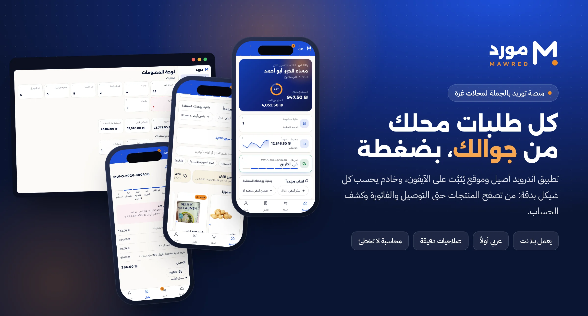
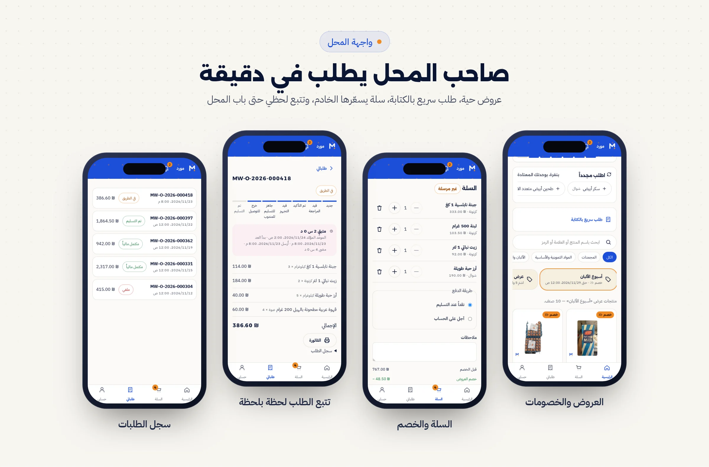
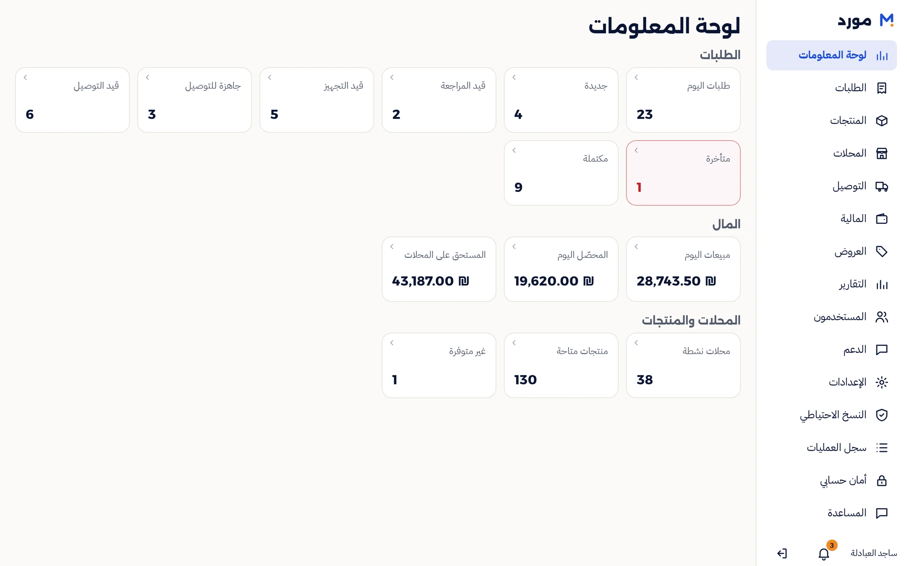
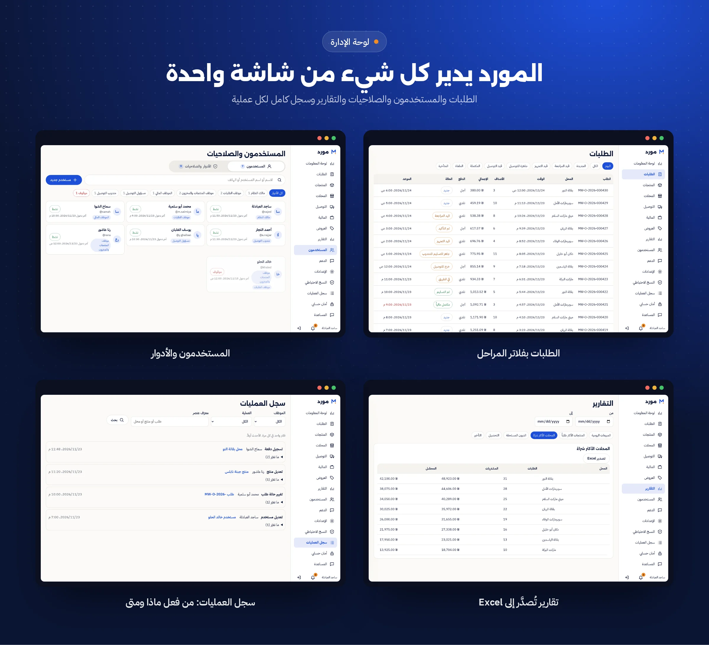
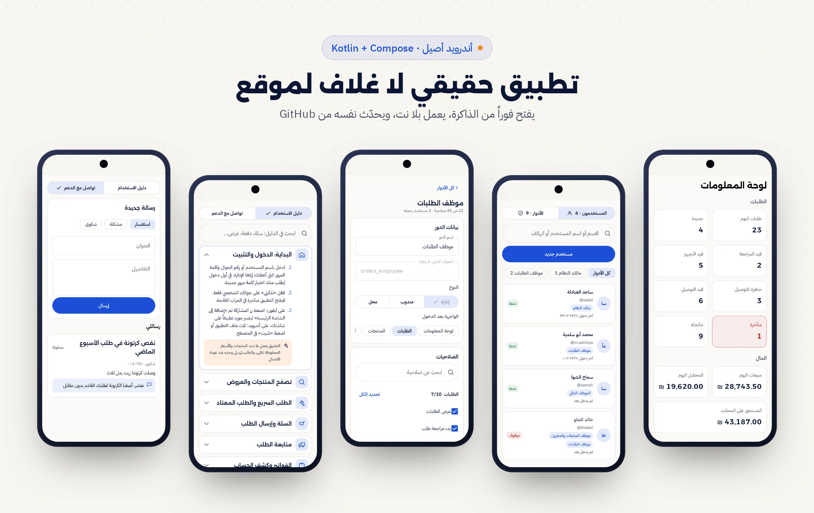
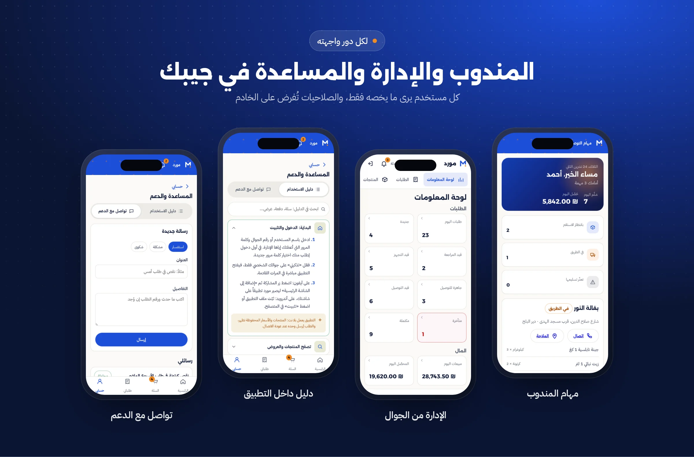

<div align="center">



# مورد · MAWRED

**منصة توريد بالجملة تربط المورد بمحلات غزة: طلب، تجهيز، توصيل، فاتورة، وكشف حساب — في تطبيق واحد**

[](https://github.com/Dev-saged/Morud/actions/workflows/android.yml)
[](https://github.com/Dev-saged/Morud/actions/workflows/worker.yml)
[](https://github.com/Dev-saged/Morud/actions/workflows/web.yml)


</div>

## الفكرة

صاحب البقالة في غزة يطلب بضاعته بالهاتف والورق، والمورد يجمع الطلبات من المكالمات ويحسب الديون بدفتر. **مورد** يحوّل هذا كله إلى نظام واحد:

- **المحل** يتصفح المنتجات بصورها وأسعارها والعروض، ويطلب في دقيقة (حتى بكتابة «3 جبنة، 2 كرتونة زيت»)، ويتابع طلبه لحظة بلحظة حتى باب المحل.
- **المورد** يستقبل الطلبات، يؤكد ويجهّز ويسند للمندوب، وكل فاتورة ودفعة ورصيد محسوب على الخادم بدقة الأغورة.
- **المندوب** يرى مهامه فقط، يفتح الطريق في الخرائط، ويسجل التسليم والتحصيل.

مصمم لواقع غزة: نت ضعيف ومنقطع، كهرباء متقطعة، جوالات متوسطة، وأحياناً جوال واحد لعدة أشخاص.



## لوحة الإدارة



كل رقم في اللوحة يفتح قائمته مباشرة: طلبات اليوم، المتأخرة عن موعد التوصيل، مبيعات اليوم والمحصّل، والمستحق على المحلات.



## أندرويد أصيل



## لكل دور واجهته



## المميزات

| | |
|---|---|
| **يعمل بلا نت** | المنتجات والأسعار تظهر من آخر نسخة، والطلب يُحفظ ويُرسل وحده **مرة واحدة فقط** عند عودة الاتصال |
| **فتح فوري** | الشاشات تظهر من الذاكرة قبل رد الخادم، والبحث في آلاف المنتجات بأقل من 2 مللي ثانية |
| **محاسبة لا تخطئ** | المال أعداد صحيحة بالأغورة، الخادم يعيد حساب كل إجمالي، الدفتر لا يُحذف منه شيء، والتصحيح بقيد عكسي |
| **فاتورة لا تتغير** | الفاتورة تحفظ سعر لحظة التأكيد؛ تعديل السعر لاحقاً لا يمس الفواتير القديمة |
| **لا تكرار** | ضغطة مزدوجة أو نت متقطع لا ينشئ طلبين ولا يسجل دفعة مرتين |
| **صلاحيات دقيقة** | 9 أدوار و56 صلاحية، مع منح أو حجب صلاحية لشخص بعينه؛ كل شيء يُفرض على الخادم لا على الجوال |
| **مراحل طلب محكومة** | جديد ← مراجعة ← تأكيد بفاتورة ← تجهيز ← توصيل ← تسليم، ولا تخطي لمرحلة دون صلاحية |
| **مؤقت بساعات العمل** | موعد التوصيل يُحسب بأيام وساعات عمل المورد ويتخطى العطل |
| **عروض حقيقية** | نسبة، مبلغ للوحدة، خصم الكمية، اشترِ واحصل، ومجموعات — تُحسب على الخادم |
| **طلب بالكتابة** | «نص كيلو زعتر، 10 سمك بوري» يُفهم بالمنتج والكمية والوحدة |
| **سجل كل عملية** | من غيّر السعر، من سجّل الدفعة، من ألغى الطلب — بالقيمة قبل وبعد |
| **نسخ احتياطي مشفر** | كل ليلة بتشفير AES-256 وبصمة، وتمرين استعادة طابق الإنتاج 100% |
| **آيفون بلا متجر** | الموقع يُثبَّت كتطبيق على الشاشة الرئيسية، مع دليل تثبيت لكل متصفح |
| **مساعدة داخل التطبيق** | دليل استخدام لكل دور مع بحث، ومراسلة الدعم من داخل التطبيق |
| **عربي أولاً** | من اليمين لليسار بالكامل، أرقام جدولية، أيقونات مرسومة يدوياً، وخط كبير دون تداخل |
| **يحدّث نفسه** | تطبيق أندرويد يكتشف الإصدار الجديد وينزّله ويثبّته |

## الجودة بالأرقام

| | |
|---|---|
| **411** اختباراً آلياً | الخادم 229 · قواعد قاعدة البيانات 13 · الويب 42 · المتصفحات 28 · أندرويد 50 · المواصفات 49 |
| **98.9%** | تغطية أسطر الخادم |
| **15** هجوماً مختبراً | حقن، XSS، تخمين، اختطاف جلسة، تلاعب بالأسعار والكميات ومعرّفات المحلات… |
| **0** مخالفة وصولية | WCAG 2.1 AA على Chrome وFirefox وSafari وAndroid، فاتح وداكن |
| **0** ثغرات | في تبعيات الخادم والويب |
| **5** سيناريوهات مالية | دفع جزئي، دفع زائد، تغيّر السعر، إرسال مكرر، إلغاء بعد دفعة — كلها مختبرة بأسمائها |

التفاصيل: [تقرير الاختبارات](docs/test-report.md) · [التقرير الأمني](docs/security-report.md)

## المعمارية

```
 المحل · المندوب · الإدارة
 ├── أندرويد  (Kotlin + Jetpack Compose)
 └── ويب PWA  (React + TypeScript)
          │  كل كتابة عبر الخادم فقط
          ▼
 Cloudflare Worker (TypeScript) ── صلاحيات · تدقيق · منع تكرار · حساب المال
          │
 Firestore (البيانات) · R2 (الصور والنسخ) · KV (الكاش) · FCM (الإشعارات) · Firebase Auth (الهوية)
```

**مصدر واحد للقواعد:** حالات الطلب والأدوار والصلاحيات ودليل الاستخدام والألوان في مجلد `spec/`، يقرؤها الخادم والويب وأندرويد معاً، فلا تختلف المنصات أبداً.

## التقنيات

**أندرويد:** Kotlin · Jetpack Compose · Hilt + KSP · Room · OkHttp · kotlinx.serialization · Android Keystore · R8
**الخادم:** Cloudflare Workers · TypeScript · Firestore REST · R2 · KV · Cron
**الويب:** React · TypeScript · Vite · PWA · Service Worker
**الجودة:** Vitest · Playwright · axe-core · Robolectric · Roborazzi · GitHub Actions

## بنية المستودع

| المجلد | المحتوى |
|---|---|
| `android/` | تطبيق أندرويد |
| `worker/` | الخادم واختباراته وأدوات التشغيل |
| `web/` | الموقع وتطبيق PWA |
| `spec/` | قواعد العمل المشتركة: الحالات، الأدوار، الصلاحيات، الدليل، رموز التصميم |
| `firebase/` | قواعد Firestore وفهارسها واختباراتها |
| `brand/` | الشعار والهوية البصرية |
| `docs/` | [مرجع API](docs/api.md) · [التشغيل والنشر](docs/operations.md) · [نموذج البيانات](docs/data-model.md) · [المعمارية](docs/architecture.md) |

<br/>

<div align="center">

## المطوّر

**ساجد العبادلة** — من غزة

أبني تطبيقات عربية أصيلة لأندرويد والويب، من الفكرة حتى التشغيل.

[](https://instagram.com/sajedd.0)
[](https://x.com/saged_al)
[](https://facebook.com/saged.t)
[](https://wa.me/972597857250)
[](https://github.com/Dev-saged)

</div>
