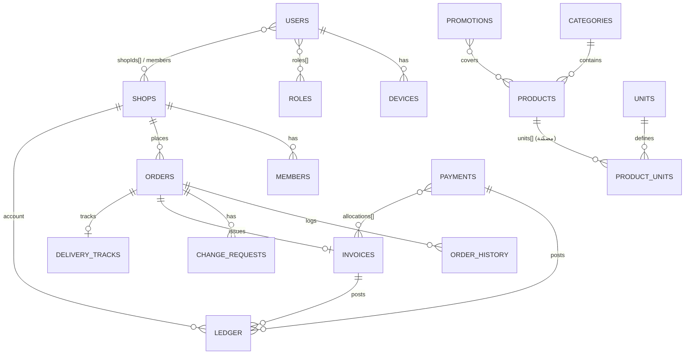

# نموذج البيانات — Firestore (مقابل جداول SRS 15.3)

> قواعد عامة: كل وثيقة تحمل `createdAt`/`updatedAt` (serverTimestamp، UTC) و`updatedBy`. المال `int` بالأغورة. الكمية `qtyMilli` (int). الحذف ناعم (`archived: true`) إلا ما ينص عليه. الحقول المالية والسجلات لا تُحذف أبداً.

## مخطط العلاقات

## المجموعات
| المجموعة | جداول SRS المقابلة | الحقول الأساسية | يقرأ (Rules) |
|---|---|---|---|
| `users/{uid}` | users, user_roles, user_permission_overrides | displayName, username, phone, email?, status(active/suspended), roles[], grant[], deny[], shopIds[], agent?, expiresAt?, mustChangePassword, lastLoginAt, sessionsRevokedAt | صاحبها + `users.manage` |
| `users/{uid}/devices/{id}` | devices, notification_devices | platform, fcmToken, appVersion, lastSeenAt | صاحبها |
| `logins/{identifier}` | user_credentials (فهرس الدخول) | uid, loginEmail | Worker فقط |
| `roles/{id}` | roles, role_permissions | label, kind, home, permissions[], protected | موظفون |
| `system/permissions` | permissions | الكتالوج + صلاحيات مضافة وقت التشغيل | موظفون |
| `shops/{id}` | shops, shop_addresses, shop_settings, shop_credit_settings | name, ownerName, phone, phoneAlt, region, city, address, geo, status, paymentTerms[], credit{enabled, limit}, balance(int، مشتق ومخزن)، allowMemberManagement, adminNotes(staff فقط عبر وثيقة فرعية) | أعضاؤه + `shops.view` |
| `shops/{id}/private/admin` | — | adminNotes | `shops.view` |
| `shops/{id}/members/{uid}` | shop_members | role(owner/employee), permissions[] على مستوى المحل | أعضاؤه |
| `categories/{id}` | categories | name, parentId?, order, icon, hidden | الجميع |
| `units/{id}` | units | name, kind, allowFraction | الجميع |
| `products/{id}` | products, product_units, product_availability, product_barcodes, product_images | name, altNames[], searchKeys[] (عربي مطبّع)، description, images[{key, thumb}], categoryId, brand, sku, barcodes[], units[{unitId, factorToBase, price, minQtyMilli, stepMilli, allowFraction}], baseUnitId, available, visible, order, featured, cost?(وثيقة خاصة) | الجميع (المرئية) |
| `products/{id}/private/cost` | — | cost per unit | `products.cost.view` |
| `promotions/{id}` | promotions, promotion_products, promotion_conditions | name, description, image, type(item/qty/bxgy/bundle/period), productIds[], percent? / amount?, startsAt, endsAt, minPurchase, maxDiscount, usageLimit, usedCount, status, terms | الجميع (الفعّالة) |
| `orders/{id}` | orders, order_items, order_approvals | number, shopId, createdBy, submittedBy, status, items[لقطات], totals{subtotal, discount, total}, promotionsApplied[], paymentMethod, notes, idempotencyKey, sla{submittedAt, clockStartAt, dueAt, estimated, overdue}, assignedTo, agentId, deliveryOrder, invoiceId, version | المحل (حسب view_all أو createdBy) + `orders.view` + المندوب المسند |
| `orders/{id}/history/{id}` | order_status_history | from, to, by, roleContext, reason, at | كقراءة الطلب |
| `orders/{id}/internal/{id}` | order_notes | text, by, at | `orders.view` فقط |
| `orders/{id}/changes/{id}` | order_change_requests | before[], after[], reason, status(pending/approved/declined), by, decidedBy | المحل + `orders.view` |
| `invoices/{id}` | invoices, invoice_items | number, orderId, shopId, supplier{}, shop{} (لقطة)، items[], totals, paid, remaining, status(open/partial/paid/void), issuedAt | المحل (`shop.invoices.view`) + `invoices.view` |
| `invoices/{id}/adjustments/{id}` | invoice_adjustments, credit_notes | type, amount, reason, ref | كقراءة الفاتورة |
| `counters/{name}` | invoice_sequences | next (يُزاد داخل المعاملة؛ ترقيم `MW-O-2026-000123` و`MW-I-2026-000045`) | Worker فقط |
| `ledger/{id}` | account_ledger, financial_adjustments, receipts | shopId, type(opening/invoice/payment/adjustment/credit_note/reversal), amount(+مدين/−دائن), ref{kind,id}, reversesId?, reason, by, roleContext, at | المحل (`shop.statement.view`) + `accounts.view` |
| `payments/{id}` | payments, payment_allocations | number, shopId, amount, method, allocations[{invoiceId, amount}], unallocated, collectedBy, proofKey?, status(posted/reversed), notes | كقراءة الدفتر |
| `deliveryTracks/{orderId}` | delivery_locations | agentId, active, points (آخر 200)، startedAt, stoppedAt | `delivery.track.view` + المندوب نفسه |
| `deliveryProofs/{orderId}` | delivery_proofs | receiverName, at, approxGeo, photoKey?, signatureKey?, note, collected | `delivery.view` + المحل |
| `notifications/{id}` | notifications | userId, type, title, body, ref, readAt, createdAt | صاحبها |
| `notificationJobs/{id}` | — | dedupeKey, targets, attempts, status, lastError | Worker فقط |
| `auditLogs/{id}` | audit_logs | actorId, roleContext, action, entity{kind,id}, affectedUserId?, before?, after?, ip, device, result, at | `audit.view` |
| `settings/system` | system_settings | انظر `spec/seed.json` | الجميع (عام) |
| `backupLogs/{id}` | backup_logs | at, objectKey, sizeBytes, sha256, status, error | `backups.manage` |
| `supportTickets/{id}` | support_tickets | shopId?, by, type, subject, body, status, assignedTo | منشئها + `support.manage` |
| `idempotency/{key}` | idempotency_keys | uid, route, resultRef, createdAt (TTL 7 أيام) | Worker فقط |
| KV: `rl:*` | login_attempts | عدّادات محاولات الدخول | — |
| Auth | user_sessions | refresh tokens + `sessionsRevokedAt` | — |

## الفهارس المركّبة الأولى
- `orders`: (shopId, createdAt desc) · (status, createdAt desc) · (agentId, status) · (sla.overdue, status)
- `ledger`: (shopId, at asc)
- `invoices`: (shopId, issuedAt desc) · (status, issuedAt desc)
- `payments`: (shopId, at desc)
- `products`: (categoryId, visible, order) · (visible, featured) · (searchKeys array-contains, visible)
- `notifications`: (userId, createdAt desc)
- `auditLogs`: (entity.kind, entity.id, at desc) · (actorId, at desc)

## القواعد الحسابية (تُختبر في الوحدة 1)
- الرصيد = Σ ledger.amount للمحل. موجب = مستحق على المحل، سالب = رصيد دائن له يُستهلك تلقائياً في الفواتير القادمة.
- دفعة أكبر من المستحق: يُخصَّص للفواتير المفتوحة الأقدم أولاً والباقي `unallocated` يظهر رصيداً دائناً.
- الحد الائتماني يمنع الطلب الآجل فقط إن `balance + total > limit` و`creditBlocksDeferredOrders`؛ النقدي لا يُمنع أبداً.
- الإلغاء بعد الفاتورة: إشعار دائن بقيمة المتبقي + عكس الدفعات المرتبطة أو تحويلها رصيداً دائناً بقرار الموظف؛ الحركة الأصلية تبقى.
